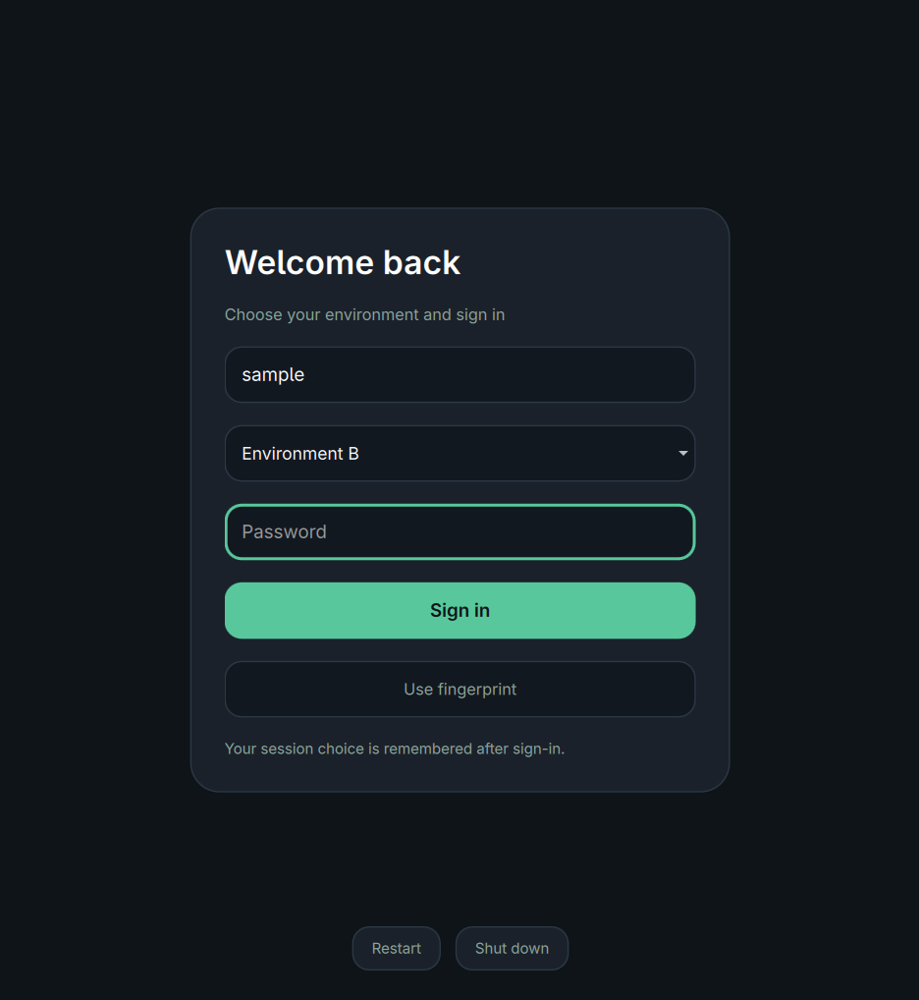

# Arch Multi-Environment Architecture (`arch-multienv`)

A robust, production-grade architecture and toolchain for hosting **multiple isolated desktop environments** on top of a single, shared Arch Linux installation.

Switch seamlessly between independent desktop profiles (e.g. Work, Gaming, Minimal, Experimental) within the same user account, sharing the Linux kernel, hardware drivers, system packages, and user data while maintaining strict configuration isolation, distinct display scaling, and crash-resilient session lifecycles.

---

## What It Is

`arch-multienv` enables an Arch Linux user to define, switch between, and maintain multiple distinct Wayland/Hyprland desktop profiles on one workstation without rebooting into different OS partitions or managing separate Unix user accounts.

- **Shared Core**: A single kernel, root filesystem, package tree (`/usr/bin`), hardware configuration, and user home directory (`$HOME`).
- **Isolated Per-Environment Layer**: Independent compositor configurations (`hyprland.conf`), display scaling factors, desktop shells/bars, autostart daemons, keybindings, and window rules.
- **Unified Switching Engine**: An intelligent CLI (`multienv`) and generic display manager integration (SDDM) allowing profile selection via the login screen chooser or one-line terminal commands.

---

## What It Is NOT

To be explicitly clear about architectural boundaries:
- **NOT a Dual Boot**: Does not require separate disk partitions, duplicate root filesystems, or dual EFI entries.
- **NOT a Virtual Machine or Container**: All environments run directly bare-metal with full GPU acceleration, zero virtualization overhead, and shared system resources.
- **NOT a Multi-User Setup**: All profiles operate within your primary user account (`$USER`). You do not need to manage secondary Unix accounts, file permissions, or duplicate dotfiles.
- **NOT a Rice Switcher Script**: Rather than frantically moving or symlinking files in `~/.config` while applications are running (which risks corruption and race conditions), each profile runs in a dedicated Wayland session envelope with isolated runtime configuration paths and visible launch failures.

---

## Architectural Overview

```text
┌─────────────────────────────────────────────────────────────────────────┐
│                           Shared Linux Base                             │
│  • Linux Kernel & Systemd PID 1        • Hardware Drivers & PipeWire     │
│  • Single User Account ($HOME)         • Shared Applications (/usr/bin)  │
│  • Compositor Binary (/usr/bin/Hyprland) • Display Manager (SDDM)        │
└────────────────────────────────────┬────────────────────────────────────┘
                                     │
                                     ▼
┌─────────────────────────────────────────────────────────────────────────┐
│                       Session Dispatch Layer (SDDM)                     │
│  • Session Discovery: /usr/share/wayland-sessions/                      │
│  • Dynamic Autologin: /etc/sddm.conf.d/autologin.conf                   │
│  • Generic Selector Theme with Full Session Chooser                    │
└──────────────────┬───────────────────────────────────┬──────────────────┘
                   │                                   │
                   ▼                                   ▼
┌─────────────────────────────────────┐ ┌─────────────────────────────────────┐
│           Environment A             │ │           Environment B             │
│                                     │ │                                     │
│  • Target: multienv-environment-a   │ │  • Target: multienv-environment-b   │
│  • Hyprland: env-a/hyprland.conf    │ │  • Hyprland: env-b/hyprland.conf    │
│  • Display Scale: 1.50x             │ │  • Display Scale: 1.25x             │
│  • Shell: Work Panel & Widgets      │ │  • Shell: Minimal / Focused Bar     │
│  • Autostart: env-a/autostart.sh    │ │  • Autostart: env-b/autostart.sh    │
│  • Teardown: env-a/teardown.sh      │ │  • Teardown: env-b/teardown.sh      │
└─────────────────────────────────────┘ └─────────────────────────────────────┘
```

---

## Key Features

1. **Visible Launch Failures**:
   The session wrapper preserves the compositor or UWSM exit status so launch errors can be diagnosed. Missing or invalid profiles fail before launching.
2. **UWSM Session Envelope**:
   Compositors are supervised under systemd user session targets (`wayland-session-envelope@*.target`) ensuring clean lifecycle tracking, environment injection, and complete process cleanup upon logout.
3. **Declarative Configuration**:
   All environments are configured in a clean, human-readable TOML file (`~/.config/multienv/multienv.toml`).
4. **Pre-Flight Validation**:
   The switching CLI automatically verifies target configuration syntax and prerequisites before modifying login state, preventing unbootable sessions.
5. **Save-Aware Session Teardown**:
   Window close requests are scoped to the selected compositor. Remaining windows pause logout with exit code 2; only explicit --force bypasses that pause. The owned UWSM envelope handles session teardown.
6. **Built-In Emergency Fallback**:
   If an invalid environment configuration is encountered, `multienv fallback` restores SDDM to manual greeter mode instantly from any virtual console (TTY).
7. **Universal AI Skill Included**:
   Includes an AI-agent skill (`skills/arch-multi-environment/`) teaching coding assistants how to safely maintain and configure the system.

---

## Quick Start

### 1. Prerequisites
Ensure you have the following packages installed on Arch Linux:
```bash
sudo pacman -S hyprland python sddm
# Recommended for systemd session envelopes:
sudo pacman -S uwsm
```

### 2. Installation
Clone the repository and run the installer:
```bash
git clone https://github.com/aarushdalal/arch-multienv.git
cd arch-multienv
./bin/multienv-install
```

### 3. Generate Session Entries
Register the configured environments with your display manager:
```bash
multienv generate-sessions
```

### 4. Inspect & Switch
```bash
# View active environment and configuration
multienv status

# List all configured environments
multienv list

# Validate configuration
multienv validate

# Switch next boot session to Environment B
multienv switch environment-b

# Or switch and log out immediately
multienv switch environment-b --now
```

---

## Repository Structure

```text
arch-multienv/
├── bin/
│   ├── multienv                  # Master management & switching CLI
│   ├── multienv-session          # Session wrapper preserving launch status
│   ├── multienv-logout           # Graceful teardown & seat-release engine
│   └── multienv-install          # System installer & uninstaller
├── config/
│   ├── multienv.toml.example     # Master declarative configuration template
│   └── multienv.env.example      # Shell environment template
├── sddm/
│   └── themes/multienv-selector/ # Generic SDDM login screen with full session chooser
├── examples/
│   ├── environment-a/            # Complete example: Primary / Production Desktop
│   └── environment-b/            # Complete example: Minimal / Development Desktop
├── skills/
│   └── arch-multi-environment/   # Universal AI-Agent Maintenance Skill
├── tests/
│   ├── run_all_tests.sh          # Automated test harness
│   └── sandbox/                  # Isolated testing sandbox
├── docs/                         # Comprehensive engineering documentation
├── LICENSE                       # MIT License
└── RELEASE_MANIFEST.md           # Extraction & sanitization manifest
```

---

## Documentation

Detailed technical documentation is available in the [`docs/`](docs/) directory:

- [Architecture Guide](docs/ARCHITECTURE.md): Deep breakdown of shared system vs isolated environment components.
- [Installation Guide](docs/INSTALLATION.md): Step-by-step setup and distribution prerequisites.
- [Configuration Guide](docs/CONFIGURATION.md): Defining new environments, scale factors, and autostart hooks.
- [Switching Lifecycle](docs/SWITCHING.md): Detailed traces of SDDM greeter, CLI switching, and teardown chains.
- [Troubleshooting Reference](docs/TROUBLESHOOTING.md): Matrix of common failure modes, logs, and remediation.
- [Disaster Recovery](docs/RECOVERY.md): Emergency TTY recovery commands and rollbacks.
- [Contributing](docs/CONTRIBUTING.md): Code style, testing standards, and pull request workflow.
- [Security Model](docs/SECURITY.md): Privilege separation, sudo usage, and secrets sanitation.
- [AI Maintenance Guide](docs/AI-MAINTENANCE.md): Instructions for AI agents managing multi-environment hosts.
- [Changelog](docs/CHANGELOG.md): Version history and release notes.

---

## Attribution & Prior Art

This project combines and refines several proven Linux desktop concepts into a cohesive architecture:
- **Hyprland Compositor (`--config` flag)**: Independent compositor config parsing.
- **UWSM (Universal Wayland Session Manager)**: Wrapping Wayland compositors into systemd user targets.
- **SDDM (Simple Desktop Display Manager)**: Multi-session desktop discovery from `/usr/share/wayland-sessions/`.
- **FreeDesktop XDG Standards**: Configuration isolation via standards-compliant environment partitioning.

We acknowledge the upstream open-source communities behind Hyprland, UWSM, SDDM, and Arch Linux for building the foundational building blocks that make this architecture possible.

---

## License

This project is licensed under the [MIT License](LICENSE).


## Refined selector preview



Native Qt component render with sample account/session data and inert
authentication and power callbacks. See tests/qml/GreeterPreview.qml.

Current payloads are checked for operational identity and credentials. Public
repository/license attribution remains intentional; older public history is
preserved. Future commits use a GitHub noreply address.
